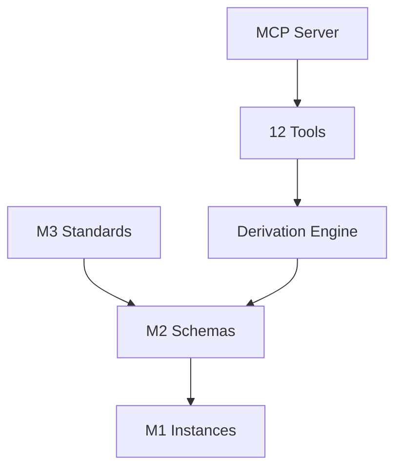

# model-driven — Architecture

> **Layer**: M0 横切框架  
> **Role**: 模型驱动生命周期引擎 — M3→M2→M1 桥接  
> **Stack**: Python, uv, pytest, ruff; zero internal eCOS deps  
> **Health**: See local CI and model validation
> **SSOT**: 运行时健康、测试通过率、工具链规模以本项目 CI、模型校验和 workspace governance SSOT 为准
>
> 系统全景参见：[`../../docs/PANORAMA.md`](../../docs/PANORAMA.md)

---

## 1. 内部架构



## 2. 入口

| Type | Entry | Port / Notes |
|:--|:--|:--|
| CLI | `model-driven` | status/pipeline/derive/... |
| MCP stdio | `src/model_driven/mcp_server.py` | MCP tools (以实际为准) / 8 managers |

## 3. 核心模块

| Module | Responsibility |
|:--|:--|
| `src/model_driven/lifecycle/stages.py` | 7 lifecycle stages + state machine |
| `src/model_driven/toolchain/tools.py` | 12 core model-driven tools |
| `src/model_driven/toolchain/derivation_engine.py` | 15 DR rules + triggers |
| `src/model_driven/mcp_server.py` | MCP server |
| `src/model_driven/cli.py` | CLI entry |

## 4. 测试

```bash
cd projects/model-driven && uv run pytest tests/ -q
```
