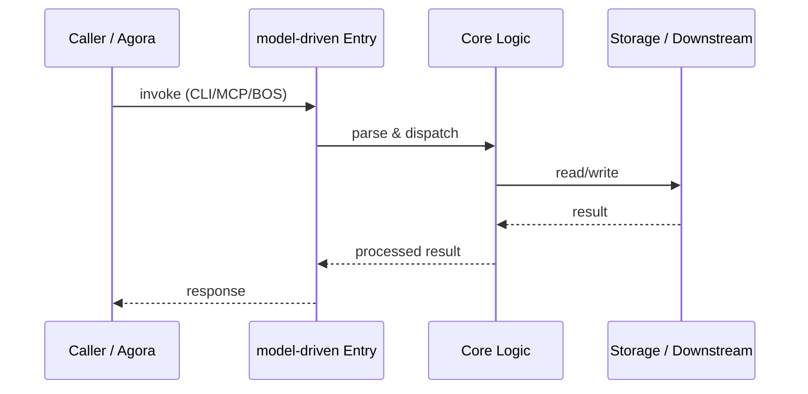

# model-driven — Call Chain

> 本文档描述 model-driven 内部最核心的一条调用链 / 数据流。
>
> 通用跨层调用链参见：[`../../docs/I0-AGORA-CALLCHAIN.md`](../../docs/I0-AGORA-CALLCHAIN.md)

---

## 关键路径

1. 1. Caller loads M3 standard definitions from `lifecycle/stages.py`
2. 2. `derivation_engine.py` applies DR rules to M2 schemas
3. 3. `toolchain/tools.py` executes lifecycle operations
4. 4. `mcp_server.py` exposes 28 tools for external callers
5. 5. Bridge sync tools write back to ecos M1 YAML

## Sequence Diagram

